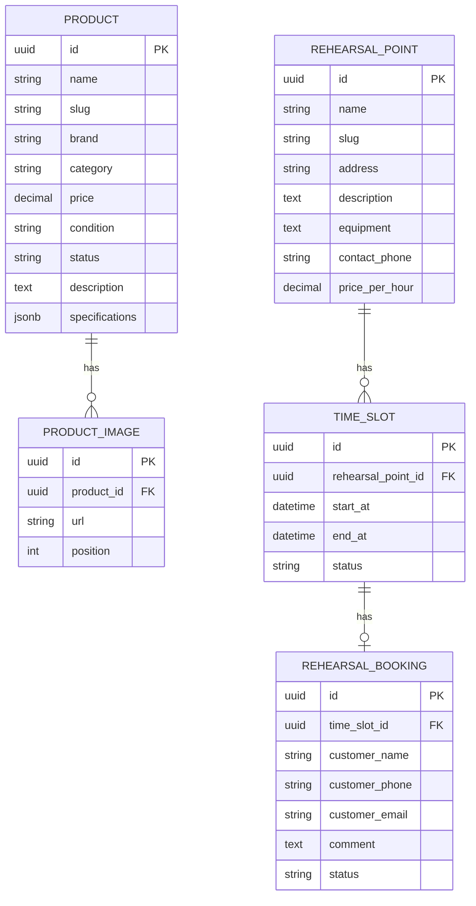

# Drum Dealer & «Ковры» — Техническое задание

**Версия:** 1.1
**Статус:** MVP — на согласование
**Дата:** 2026-11-04

---

## 1. Общая информация

### 1.1. Описание проекта

Разработка единого адаптивного веб-сайта для двух направлений бизнеса:

- **Drum Dealer** — каталог музыкальных инструментов и оборудования из Японии с приоритетом на барабаны.
- **«Ковры»** — две репетиционные точки с возможностью просмотра свободного времени и отправки заявки на бронирование.

Сайт объединяет оба направления в одном интерфейсе, но сохраняет их самостоятельную визуальную идентичность и пользовательские сценарии.

### 1.2. Основные параметры

| Параметр             | Значение                                      |
| -------------------- | --------------------------------------------- |
| Заказчик             | Drum Dealer                                   |
| Продукт              | Единый сайт двух направлений бизнеса          |
| Тип                  | Каталог товаров + система заявок на репетиции |
| Язык                 | Русский                                       |
| Платформа            | Web                                           |
| Адаптивность         | Desktop, tablet, mobile                       |
| Валюта               | RUB                                           |
| Онлайн-оплата        | Не предусмотрена                              |
| Регистрация клиентов | Не предусмотрена                              |

### 1.3. Бренды

| Бренд       | Назначение                                 |
| ----------- | ------------------------------------------ |
| Drum Dealer | Продажа музыкальных инструментов из Японии |
| «Ковры»     | Почасовая аренда репетиционных помещений   |

---

## 2. Цели и задачи

### 2.1. Бизнес-цели

1. Создать удобную онлайн-витрину товаров Drum Dealer.
2. Предоставить посетителям возможность ознакомиться с репетиционными точками «Ковры» и отправить заявку на бронирование.
3. Упростить управление товарами, расписанием и заявками.
4. Объединить два направления бизнеса на одной площадке.
5. Создать основу для дальнейшего развития проекта.

### 2.2. Задачи MVP

- Разработать публичную часть сайта.
- Реализовать каталог товаров и страницы отдельных товаров.
- Реализовать страницы двух репетиционных точек.
- Реализовать отображение доступных временных слотов.
- Реализовать отправку заявок на бронирование.
- Реализовать административную панель.
- Реализовать управление товарами, расписанием и заявками.
- Обеспечить адаптивность и базовую SEO-оптимизацию.

### 2.3. Не входит в MVP

- Корзина и онлайн-оплата.
- Бронирование и резервирование товаров.
- Личный кабинет покупателя или клиента.
- Регистрация пользователей.
- Автоматическая генерация расписания.
- Интеграция с CRM, 1С и внешними системами.
- Telegram-бот.
- Email-рассылки и автоматические уведомления клиентам.
- Несколько ролей администраторов.
- Мультиязычность.
- Расширенная система аналитики.
- Сложный CMS-редактор.
- Массовое редактирование и CSV-экспорт.

---

## 3. Роли пользователей

### 3.1. Гость

Неавторизованный посетитель сайта.

Возможности:

- Просматривать каталог товаров.
- Использовать фильтры каталога.
- Открывать карточки товаров.
- Просматривать репетиционные точки.
- Просматривать доступное расписание.
- Отправлять заявки на бронирование.
- Просматривать контактную информацию.

### 3.2. Администратор

Единственный пользователь с доступом к административной панели.

Возможности:

- Управлять товарами.
- Загружать фотографии товаров.
- Управлять статусами товаров.
- Управлять репетиционными точками.
- Создавать и блокировать временные слоты.
- Просматривать заявки.
- Подтверждать и отклонять заявки.
- Отменять подтверждённые записи.

В MVP используется одна учётная запись администратора.

---

## 4. Функциональные требования

### 4.1. Главная страница

Главная страница должна представлять оба направления бизнеса.

Содержит:

1. Шапку сайта с логотипами/названиями брендов и навигацией.
2. Основной промоблок Drum Dealer.
3. Основной промоблок «Ковры».
4. Краткое описание каждого направления.
5. Быстрые ссылки на каталог и репетиционные точки.
6. Контактную информацию.
7. Подвал сайта.

Главная страница должна явно разделять два направления и предоставлять быстрый переход к нужному разделу.

### 4.2. Каталог товаров — Drum Dealer

#### 4.2.1. Страница каталога

Отображает список товаров, доступных для просмотра.

Карточка товара содержит:

- Основное изображение.
- Название.
- Бренд.
- Состояние.
- Цену.
- Статус наличия.
- Ссылку на подробную страницу.

Фильтрация MVP:

- Категория.
- Бренд.
- Состояние: новый / б/у.

Дополнительно:

- Поиск по названию товара.
- Сортировка по цене.
- Сортировка по дате добавления.
- Пагинация.

В каталоге отображаются товары со статусами:

- В наличии.
- Продан.
- Скрыт.

Скрытые товары не отображаются публично.

Проданные товары могут оставаться в каталоге с соответствующей отметкой.

#### 4.2.2. Карточка товара

Содержит:

- Название товара.
- Бренд и модель.
- Цену.
- Состояние.
- Статус наличия.
- Основное изображение.
- Галерею дополнительных изображений.
- Описание.
- Характеристики.
- Контакты продавца.

Кнопка основного действия — «Связаться с продавцом».

Переход по кнопке открывает доступный канал связи: телефон, Telegram или другой предоставленный заказчиком контакт.

**В MVP нет бронирования товара, корзины и оформления заказа.**

### 4.3. Репетиционные точки — «Ковры»

#### 4.3.1. Список репетиционных точек

Отображаются две репетиционные точки.

Карточка точки содержит:

- Название.
- Фотографию.
- Адрес.
- Краткое описание.
- Кнопку «Подробнее».

#### 4.3.2. Страница репетиционной точки

Содержит:

- Название точки.
- Адрес.
- Контактный телефон.
- Фотографии помещения.
- Описание помещения.
- Оборудование.
- Стоимость аренды (если предоставлена).
- Часы работы.
- Календарь доступности.

Календарь отображает расписание на неделю.

Состояния временных слотов:

| Статус    | Значение                      |
| --------- | ----------------------------- |
| AVAILABLE | Свободное время               |
| PENDING   | Ожидает подтверждения         |
| BOOKED    | Бронирование подтверждено     |
| BLOCKED   | Время закрыто администратором |

Пользователь может выбрать только свободный слот.

#### 4.3.3. Форма бронирования

Поля:

- Имя — обязательно.
- Телефон — обязательно.
- Email — необязательно.
- Комментарий — необязательно.
- Согласие на обработку персональных данных — обязательно.

После отправки:

1. Сервер проверяет корректность данных.
2. Сервер повторно проверяет доступность выбранного слота.
3. Создаётся заявка со статусом PENDING.
4. Слот становится недоступен для других заявок.
5. Пользователь получает сообщение об успешной отправке.
6. Заявка появляется в административной панели.

Важно: отправка заявки не означает автоматического подтверждения бронирования.

Администратор должен вручную подтвердить или отклонить заявку.

#### 4.3.4. Правила бронирования

- Один временной слот может иметь не более одной активной заявки.
- Заявка PENDING временно занимает слот.
- После подтверждения слот получает статус BOOKED.
- После отклонения заявки слот возвращается в AVAILABLE.
- После отмены подтверждённой записи слот возвращается в AVAILABLE.
- Администратор может вручную заблокировать свободный слот.
- Заблокированный слот нельзя забронировать.

В MVP администратор самостоятельно создаёт временные слоты и управляет ими.

Автоматическая генерация расписания и автоматическое истечение заявок не реализуются.

---

## 5. Административная панель

Административная панель доступна только после авторизации.

### 5.1. Авторизация

- Вход по email и паролю.
- Хранение пароля только в виде хеша.
- Ограничение количества попыток входа.
- Защищённые административные маршруты.

Восстановление пароля через email в MVP не реализуется. Первоначальная учётная запись создаётся при настройке проекта.

### 5.2. Главная панель

Отображает:

- Количество товаров.
- Количество доступных товаров.
- Количество новых заявок.
- Количество ожидающих подтверждения бронирований.
- Последние заявки.

### 5.3. Управление товарами

Администратор может:

- Просматривать список товаров.
- Создавать товар.
- Редактировать товар.
- Удалять товар.
- Изменять статус товара.
- Загружать и удалять изображения.

Поля товара:

| Поле           | Тип      | Обязательное |
| -------------- | -------- | ------------ |
| Название       | String   | Да           |
| Slug           | String   | Да           |
| Бренд          | String   | Нет          |
| Категория      | String   | Да           |
| Цена           | Decimal  | Да           |
| Состояние      | Enum     | Да           |
| Статус         | Enum     | Да           |
| Описание       | Text     | Нет          |
| Характеристики | JSON     | Нет          |
| Изображения    | Relation | Нет          |

Характеристики хранятся в JSONB и могут отличаться для разных категорий товаров.

Отдельный конструктор динамических характеристик не реализуется.

### 5.4. Управление расписанием

Администратор может:

- Выбрать репетиционную точку.
- Просматривать расписание на неделю.
- Создавать временные слоты.
- Блокировать свободные слоты.
- Разблокировать заблокированные слоты.
- Просматривать связанные заявки.

В MVP используется фиксированная продолжительность слота — 1 час.

Изменение длительности слота и автоматическое формирование расписания не входят в MVP.

### 5.5. Управление заявками

Администратор видит список заявок с полями:

- Дата и время создания.
- Репетиционная точка.
- Дата и время бронирования.
- Имя клиента.
- Телефон.
- Email.
- Комментарий.
- Статус заявки.

Возможные действия:

- Подтвердить заявку.
- Отклонить заявку.
- Отменить подтверждённую запись.

Все изменения статусов должны синхронно обновлять состояние временного слота.

---

## 6. Модель данных

### 6.1. Основные сущности

#### Admin

Администратор системы.

Поля:

- id
- email
- passwordHash
- createdAt
- updatedAt

#### Product

Товар каталога.

Поля:

- id
- name
- slug
- brand
- category
- price
- condition
- status
- description
- specifications (JSONB)
- createdAt
- updatedAt

#### ProductImage

Изображение товара.

Поля:

- id
- productId
- url
- position
- createdAt

Один товар может иметь несколько изображений.

#### RehearsalPoint

Репетиционная точка.

Поля:

- id
- name
- slug
- address
- description
- equipment
- contactPhone
- pricePerHour
- createdAt
- updatedAt

#### TimeSlot

Временной слот репетиционной точки.

Поля:

- id
- rehearsalPointId
- startAt
- endAt
- status
- createdAt
- updatedAt

#### RehearsalBooking

Заявка на бронирование.

Поля:

- id
- timeSlotId
- customerName
- customerPhone
- customerEmail
- comment
- status
- createdAt
- updatedAt

### 6.2. Связи



### 6.3. Правила хранения данных

- Первичные ключи — UUID.
- Время хранится с учётом часового пояса (timestamptz).
- Для временных слотов используется уникальность точки и времени начала.
- Статус заявки и статус слота изменяются в одной транзакции.
- Нельзя допускать одновременного создания двух активных заявок на один слот.
- При удалении товара изображения должны обрабатываться согласованно с записью товара.

---

## 7. Нефункциональные требования

### 7.1. Производительность

- Оптимизация изображений.
- Пагинация каталога.
- Серверный рендеринг публичных страниц.
- Использование WebP/AVIF при наличии подходящего пайплайна.
- Отсутствие тяжёлых клиентских зависимостей без необходимости.

### 7.2. SEO

- ЧПУ для товаров и репетиционных точек.
- Уникальные title и description.
- Open Graph.
- sitemap.xml.
- robots.txt.
- Семантическая HTML-разметка.

Сложный редактор SEO-полей в MVP не нужен.

### 7.3. Безопасность

- HTTPS.
- Хеширование паролей (Argon2 или bcrypt).
- Валидация входных данных на сервере.
- Защита административных маршрутов.
- Rate limiting на авторизацию и публичные формы.
- Honeypot или другой простой механизм защиты от спама.
- Проверка доступности слота непосредственно перед созданием заявки.
- Секреты хранятся в переменных окружения.
- Персональные данные клиентов не выдаются публичным API.

### 7.4. Адаптивность и доступность

Поддерживаемые ширины:

- 360 px.
- 768 px.
- 1024 px.
- 1440 px.

Интерфейс должен быть удобен на мобильных устройствах.

Необходимо обеспечить:

- Контрастность текста.
- Видимые состояния интерактивных элементов.
- Подписи полей форм.
- Alt-тексты изображений.
- Навигацию с клавиатуры для основных сценариев.

### 7.5. Надёжность

- Обработка ошибок API.
- Логирование серверных ошибок.
- Резервное копирование базы данных.
- Корректное поведение при повторной отправке формы.
- Защита от конфликтов при бронировании.

---

## 8. Технологический стек

Для MVP используется следующий стек.

| Слой                 | Технология               |
| -------------------- | ------------------------ |
| Frontend             | Next.js                  |
| Язык                 | TypeScript               |
| UI                   | React                    |
| Стили                | Tailwind CSS             |
| Backend              | NestJS                   |
| API                  | REST                     |
| Документация API     | Swagger / OpenAPI        |
| Database             | PostgreSQL               |
| ORM                  | Prisma                   |
| Авторизация          | JWT или серверная сессия |
| Хеширование паролей  | Argon2 / bcrypt          |
| Хранение изображений | S3-compatible storage    |
| Контейнеризация      | Docker                   |
| CI/CD                | GitHub Actions           |

### 8.1. Архитектура

Проект состоит из двух приложений:

- Frontend — Next.js.
- Backend — NestJS.

Оба приложения используют общий PostgreSQL.

Frontend взаимодействует с backend через REST API.

```text
                  ┌────────────────────┐
                  │      Browser       │
                  └─────────┬──────────┘
                            │
                            ▼
                  ┌────────────────────┐
                  │      Next.js       │
                  │     Frontend       │
                  └─────────┬──────────┘
                            │ REST API
                            ▼
                  ┌────────────────────┐
                  │      NestJS        │
                  │      Backend       │
                  └──────┬───────┬─────┘
                         │       │
                         ▼       ▼
                 ┌──────────┐ ┌──────────┐
                 │PostgreSQL│ │    S3    │
                 │          │ │  Images  │
                 └──────────┘ └──────────┘
```

### 8.2. Структура репозитория

Репозиторий использует npm workspaces. Команда `npm run dev` из корня запускает frontend и backend одновременно; отдельные команды приведены ниже.

```text
drum-dealer/
├── apps/
│   ├── frontend/
│   │   ├── src/app/            # публичные страницы и /admin
│   │   ├── src/components/     # общие UI-компоненты
│   │   ├── src/lib/            # клиент API и утилиты
│   │   ├── public/
│   │   ├── next.config.ts
│   │   └── package.json
│   │
│   └── backend/
│       ├── src/
│       │   ├── app.module.ts
│       │   ├── main.ts
│       │   └── health.controller.ts
│       ├── prisma/schema.prisma
│       └── package.json
│
├── docs/
│   ├── api/
│   ├── design/
│   └── decisions/
├── .github/workflows/ci.yml
├── package.json               # общая точка входа и npm workspaces
├── tsconfig.base.json
├── docker-compose.yml
├── .env.example
└── README.md
```

#### Локальный запуск

1. Установить Node.js 20.11 или новее и Docker Compose.
2. Скопировать `.env.example` в `.env` и при необходимости заменить секреты.
3. Выполнить `npm install` в корне репозитория.
4. Запустить PostgreSQL командой `npm run db:up`.
5. Сгенерировать Prisma Client и применить миграции: `npm run db:generate`, затем `npm run db:migrate`.
6. Запустить оба приложения командой `npm run dev`.

Frontend будет доступен на `http://localhost:3000`, backend — на `http://localhost:4000`, Swagger — на `http://localhost:4000/api/docs`.

---

## 9. Структура сайта

### 9.1. Публичная часть

```text
/
├── /catalog
│   └── /catalog/:slug
│
├── /kovry
│   └── /kovry/:slug
│
├── /about
└── /contacts
```

Назначение страниц:

| URL            | Страница                    |
| -------------- | --------------------------- |
| /              | Главная                     |
| /catalog       | Каталог товаров             |
| /catalog/:slug | Карточка товара             |
| /kovry         | Список репетиционных точек  |
| /kovry/:slug   | Страница точки и расписание |
| /about         | О проекте                   |
| /contacts      | Контакты                    |

### 9.2. Административная часть

```text
/admin
├── /login
├── /dashboard
├── /products
│   ├── /new
│   └── /:id/edit
├── /schedule
└── /bookings
```

---

## 10. Дизайн и визуальная концепция

### 10.1. Общая идея

Дизайн сайта выполняется в стилистике **советского конструктивизма и советских агитационных плакатов**.

Главный визуальный акцент — репетиционные точки «Ковры».

Визуальный образ должен ассоциироваться с музыкой, репетициями, энергией, индустриальной эстетикой и типографикой плакатов 1920–1930-х годов.

### 10.2. Цветовая палитра

| Цвет     | HEX     | Использование                       |
| -------- | ------- | ----------------------------------- |
| Красный  | #D52B1E | Основные акценты, CTA, геометрия    |
| Чёрный   | #171717 | Заголовки, текст, контрастные блоки |
| Молочный | #F3EBDD | Основной фон                        |
| Белый    | #FFFFFF | Карточки и светлые поверхности      |
| Серый    | #77736D | Второстепенный текст                |

### 10.3. Графические приёмы

- Крупная типографика.
- Диагональные полосы и геометрические фигуры.
- Контрастные композиции.
- Чёрно-белые фотографии с эффектом растра.
- Фактура старой бумаги и печатной краски.
- Небольшие декоративные элементы, напоминающие типографскую печать.
- Асимметричные композиции.

### 10.4. Типографика

Для заголовков — выразительный плотный гротеск с характером плакатной типографики.

Для основного текста — простой хорошо читаемый sans-serif.

Декоративные шрифты не должны ухудшать читаемость интерфейса.

### 10.5. Приоритет брендов

«Ковры» — главный визуальный акцент общей композиции.

Drum Dealer должен выглядеть как самостоятельное направление, но визуально оставаться частью общей системы.

### 10.6. Иллюстрации

Для оформления используются:

- Фотографии барабанов и музыкального оборудования.
- Фотографии репетиционных помещений.
- Растровые изображения музыкантов.
- Геометрические плакатные композиции.
- Иллюстративные элементы в стиле советской печатной графики.

Фотографии реальных товаров и помещений предоставляет заказчик.

---

## 11. Этапы разработки

| Этап                    | Содержание                                        | Результат          |
| ----------------------- | ------------------------------------------------- | ------------------ |
| 1. Уточнение требований | Согласование бизнес-правил, контента и расписания | Финальное ТЗ       |
| 2. Проектирование       | ER-диаграмма, API-контракты, прототипы            | Технический проект |
| 3. Backend              | База данных, API, авторизация, бизнес-логика      | Работающий backend |
| 4. Frontend             | Главная, каталог, товары, точки и формы           | Публичная часть    |
| 5. Админ-панель         | Товары, расписание, заявки                        | Рабочая админка    |
| 6. Тестирование         | Проверка сценариев и исправление ошибок           | Стабильный MVP     |
| 7. Запуск               | Деплой, домен, HTTPS, резервное копирование       | Production         |

---

## 12. Критерии приёмки MVP

### Публичная часть

- [ ] Главная страница отображает оба направления бизнеса.
- [ ] Пользователь может открыть каталог.
- [ ] Пользователь может фильтровать товары.
- [ ] Пользователь может открыть карточку товара.
- [ ] На карточке отображаются фотографии, описание, цена и статус.
- [ ] Пользователь может перейти к контактам продавца.
- [ ] Пользователь может просмотреть список репетиционных точек.
- [ ] Пользователь может открыть страницу конкретной точки.
- [ ] Пользователь видит расписание на неделю.
- [ ] Пользователь может выбрать свободный слот.
- [ ] Пользователь может отправить заявку.
- [ ] После отправки пользователь видит сообщение об успешной отправке.
- [ ] Нельзя отправить заявку на уже занятый или заблокированный слот.

### Административная панель

- [ ] Администратор может авторизоваться.
- [ ] Администратор может просматривать товары.
- [ ] Администратор может создавать товары.
- [ ] Администратор может редактировать товары.
- [ ] Администратор может удалять товары.
- [ ] Администратор может загружать изображения.
- [ ] Администратор может менять статус товара.
- [ ] Администратор может создавать временные слоты.
- [ ] Администратор может блокировать и разблокировать слоты.
- [ ] Администратор видит список заявок.
- [ ] Администратор может подтвердить заявку.
- [ ] Администратор может отклонить заявку.
- [ ] Администратор может отменить подтверждённую запись.
- [ ] Статусы заявок и слотов синхронизируются корректно.

### Технические требования

- [ ] Frontend и backend запускаются независимо.
- [ ] База данных разворачивается через Docker.
- [ ] API документировано через Swagger.
- [ ] Публичные страницы адаптированы под мобильные устройства.
- [ ] Административные маршруты защищены.
- [ ] Публичные формы валидируются на сервере.
- [ ] Реализована защита от повторного бронирования одного слота.
- [ ] Настроен HTTPS на production.
- [ ] Настроено резервное копирование базы данных.

---

## 13. Риски и допущения

| Риск                             | Решение                                                    |
| -------------------------------- | ---------------------------------------------------------- |
| Две заявки на один слот          | Транзакции и ограничения на уровне БД                      |
| Спам через формы                 | Rate limiting и honeypot                                   |
| Потеря заявок                    | Хранение в БД и резервное копирование                      |
| Задержка предоставления контента | Сбор фотографий и описаний до разработки публичных страниц |
| Сложность расписания             | В MVP ручное создание временных слотов                     |
| Рост каталога                    | Пагинация и индексация БД                                  |

### 13.1. Допущения MVP

1. У проекта один администратор.
2. Клиенты не регистрируются.
3. Товары не бронируются через сайт.
4. Продажа товара происходит через прямую связь с продавцом.
5. Заявки на репетиции подтверждаются вручную.
6. Продолжительность одного слота — 1 час.
7. Расписание создаётся администратором вручную.
8. Заказчик предоставляет фотографии, описания, цены и контактные данные.
9. Сайт работает на русском языке.
10. Часовой пояс расписания определяется местоположением репетиционной точки.

---

## 14. Возможности развития после MVP

Функции, которые можно добавить после запуска первой версии:

- Автоматическая генерация расписания.
- Выбор нескольких последовательных часов.
- Настраиваемая длительность слотов.
- Уведомления в Telegram.
- Email-уведомления.
- Онлайн-оплата аренды.
- Бронирование товаров.
- Расширенные фильтры каталога.
- Поиск по характеристикам.
- Несколько администраторов и роли.
- Управление контентом через CMS.
- CSV-экспорт.
- Статистика и аналитика.
- Мультиязычность.
- Интеграция с CRM.

---

**Основной результат:** единый адаптивный сайт Drum Dealer и «Ковры» с каталогом музыкальных инструментов, расписанием репетиционных точек и административной панелью для управления товарами, слотами и заявками.
