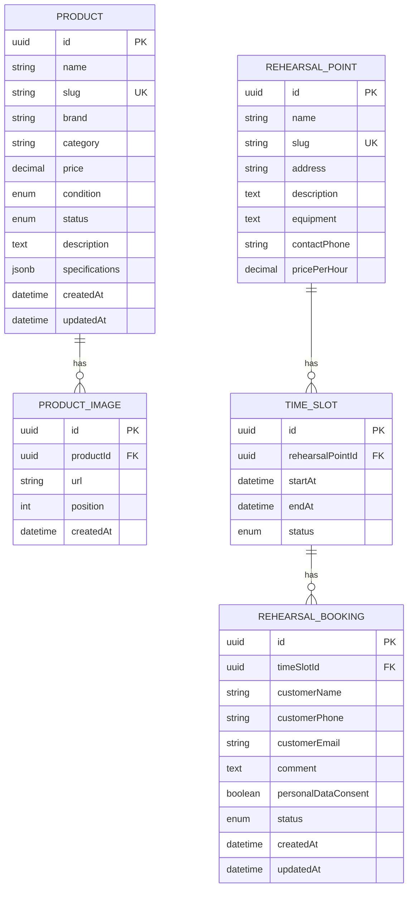

# API

Контракт REST API для MVP Drum Dealer и «Ковров». Все маршруты имеют префикс
`/api`. Swagger UI: `/api/docs` (локально: `http://localhost:4000/api/docs`).

Контракт описывает целевое поведение. На текущем этапе в backend реализован
только `GET /api/health`; остальные маршруты добавляются вместе с модулями.

## Общие правила

- Формат запросов и ответов — JSON, кроме загрузки файлов.
- Идентификаторы сущностей — UUID.
- Даты и время передаются в RFC 3339 с часовым поясом, например
  `2026-11-05T18:00:00+03:00`. В базе время хранится как `timestamptz`.
- Денежные значения передаются десятичными строками, чтобы не терять точность:
  например, `"12500.00"`. Валюта — RUB.
- Поля пароля и `passwordHash` никогда не возвращаются API.
- Публичные ответы не содержат имён, телефонов, email и комментариев клиентов.
- Все административные маршруты, кроме входа, требуют JWT в заголовке
  `Authorization: Bearer <token>`.
- Неизвестные входные поля отклоняются. Backend использует глобальную
  валидацию с `whitelist` и `transform`.

### Пагинация и ошибки

Списки поддерживают `page` (начиная с 1) и `pageSize` (по умолчанию 20,
максимум 100). Ответ списка:

```json
{
  "data": [],
  "meta": { "page": 1, "pageSize": 20, "total": 0, "totalPages": 0 }
}
```

Ошибки возвращаются в едином формате:

```json
{
  "statusCode": 409,
  "code": "SLOT_UNAVAILABLE",
  "message": "Выбранное время уже недоступно"
}
```

Основные HTTP-статусы:

| Статус | Использование                                 |
| ------ | --------------------------------------------- |
| 400    | Невалидные параметры или тело запроса         |
| 401    | Не выполнен вход или истёк токен              |
| 403    | Недостаточно прав                             |
| 404    | Ресурс не найден                              |
| 409    | Конфликт состояния, занятый слот или дубликат |
| 429    | Превышен лимит запросов                       |
| 500    | Внутренняя ошибка сервера                     |

## Статусы и связи

Значения enum совпадают с Prisma-схемой.

| Сущность         | Поле        | Значения                                        |
| ---------------- | ----------- | ----------------------------------------------- |
| Product          | `condition` | `NEW`, `USED`                                   |
| Product          | `status`    | `AVAILABLE`, `SOLD`, `HIDDEN`                   |
| TimeSlot         | `status`    | `AVAILABLE`, `PENDING`, `BOOKED`, `BLOCKED`     |
| RehearsalBooking | `status`    | `PENDING`, `CONFIRMED`, `REJECTED`, `CANCELLED` |



`Product` имеет несколько изображений; `RehearsalPoint` — несколько слотов;
`TimeSlot` хранит несколько заявок, включая отклонённые и отменённые. Для
слота уникальна пара `(rehearsalPointId, startAt)`. В MVP продолжительность
слота — один час. Одновременно на слот допускается не более одной активной
заявки (`PENDING` или `CONFIRMED`).

## Проверка доступности

### `GET /api/health`

Проверка доступности приложения. Не требует авторизации.

```json
{ "status": "ok" }
```

## Публичный API

### Каталог товаров

#### `GET /api/products`

Возвращает товары, доступные для публичного просмотра. `HIDDEN` не возвращаются;
`SOLD` могут отображаться.

Query-параметры:

| Параметр           | Описание                                      |
| ------------------ | --------------------------------------------- |
| `page`, `pageSize` | Пагинация                                     |
| `category`         | Точное совпадение категории                   |
| `brand`            | Фильтр по бренду                              |
| `condition`        | `NEW` или `USED`                              |
| `q`                | Поиск по названию                             |
| `sort`             | `price_asc`, `price_desc`, `newest`, `oldest` |

Каждый товар включает `id`, `name`, `slug`, `brand`, `category`, `price`,
`condition`, `status`, `description`, `specifications`, `images`, `createdAt`
и `updatedAt`. Изображение содержит `id`, `url` и `position`.

#### `GET /api/products/:slug`

Возвращает товар по slug с галереей. Скрытый товар недоступен публично и
возвращает `404`.

### Репетиционные точки и расписание

#### `GET /api/rehearsal-points`

Возвращает список публичных точек: `id`, `name`, `slug`, `address`,
`description`, `equipment`, `contactPhone` и `pricePerHour`.

#### `GET /api/rehearsal-points/:slug`

Возвращает точку по slug и её публичные данные. Связанные заявки и данные
клиентов не включаются.

#### `GET /api/rehearsal-points/:slug/slots?from=...&to=...`

Возвращает слоты точки за период `[from, to)`. Клиент запрашивает неделю,
показываемую в календаре. Для каждого слота возвращаются `id`, `startAt`,
`endAt` и `status`; данные бронирования не возвращаются.

Пользователь может отправить заявку только на слот со статусом `AVAILABLE`.
`PENDING`, `BOOKED` и `BLOCKED` остаются видимыми как недоступные интервалы.

### Заявки на бронирование

#### `POST /api/bookings`

Создаёт заявку со статусом `PENDING`. Доступность проверяется сервером
непосредственно перед записью; создание заявки и перевод слота в `PENDING`
выполняются атомарно.

```json
{
  "timeSlotId": "8c41c111-8711-4fa2-9dd2-69e63f2e7217",
  "customerName": "Иван",
  "customerPhone": "+79990000000",
  "customerEmail": "ivan@example.com",
  "comment": "Нужен микрофон",
  "personalDataConsent": true
}
```

`timeSlotId`, `customerName`, `customerPhone` и `personalDataConsent: true`
обязательны; email и комментарий необязательны. При `false` или отсутствии
согласия сервер отвечает `400`. Факт согласия `true` сохраняется вместе с
заявкой.

Ответ `201 Created` содержит публичное подтверждение приёма заявки, например:

```json
{
  "data": {
    "id": "f1937d0b-f140-4385-9f35-74f49e810fc4",
    "status": "PENDING",
    "timeSlotId": "8c41c111-8711-4fa2-9dd2-69e63f2e7217"
  }
}
```

Если слот уже занят или заблокирован, сервер возвращает `409 SLOT_UNAVAILABLE`.
После отклонения заявки или отмены подтверждённой записи слот снова доступен,
а новая заявка создаёт отдельную запись в истории. Повторная отправка не должна
создавать вторую активную заявку. Для защиты от гонки сервер в транзакции
атомарно меняет статус слота с `AVAILABLE` на `PENDING` условным обновлением;
только запрос, изменивший одну запись, может создать заявку. Этот endpoint
защищается rate limiting и honeypot/антиспам-проверкой; персональные данные не
включаются в публичный ответ.

## Административный API

Все маршруты `/api/admin/*`, кроме входа, требуют JWT авторизации и доступны
только единственному администратору. Токен передаётся в заголовке
`Authorization: Bearer <token>`. Отсутствующий, недействительный или истёкший
токен даёт `401`; валидный токен без прав администратора — `403`.

### Авторизация и сводка

| Метод и путь                 | Назначение                                                                           |
| ---------------------------- | ------------------------------------------------------------------------------------ |
| `POST /api/admin/auth/login` | Вход по `email` и `password`; возвращает JWT и данные администратора без хеша пароля |
| `GET /api/admin/dashboard`   | Счётчики и последние заявки для панели                                               |

Ответ успешного входа содержит `accessToken`, `tokenType: "Bearer"`, срок
действия токена и безопасные данные администратора (`id`, `email`). Для
stateless JWT отдельный endpoint выхода не используется: клиент удаляет токен,
а сервер отклоняет его после истечения срока действия. Вход ограничивается по
частоте; пароль хранится только в виде хеша.

Сводка содержит общее число товаров, число товаров `AVAILABLE`, число новых
заявок и число заявок `PENDING`, а также последние заявки.

### Товары и изображения

| Метод и путь                                     | Назначение                                                           |
| ------------------------------------------------ | -------------------------------------------------------------------- |
| `GET /api/admin/products`                        | Список всех товаров, включая `HIDDEN`; фильтр по статусу и пагинация |
| `POST /api/admin/products`                       | Создать товар                                                        |
| `GET /api/admin/products/:id`                    | Получить товар для редактирования                                    |
| `PATCH /api/admin/products/:id`                  | Изменить переданные поля товара                                      |
| `DELETE /api/admin/products/:id`                 | Удалить товар и связанные изображения                                |
| `POST /api/admin/products/:id/images`            | Загрузить изображение (`multipart/form-data`)                        |
| `PATCH /api/admin/products/:id/images/:imageId`  | Изменить позицию изображения                                         |
| `DELETE /api/admin/products/:id/images/:imageId` | Удалить изображение                                                  |

Для создания товара обязательны `name`, `slug`, `category`, `price`,
`condition` и `status`. Необязательные поля: `brand`, `description`,
`specifications` (JSON-объект). Slug уникален. Товар и его изображения
соответствуют сущностям `Product` и `ProductImage`.

Изображения хранятся в S3-compatible storage. Endpoint загрузки принимает
`multipart/form-data` с полем `file`; допустимы только JPG/JPEG, PNG и WebP,
максимум 10 изображений на товар. Сервер проверяет фактический тип файла, а не
только `Content-Type`. Ответ содержит созданные `id`, `url` и `position`.
Удаление изображения или товара удаляет соответствующие объекты из S3 и записи
из БД согласованно. Максимальный размер одного файла нужно определить в
конфигурации до реализации.

### Репетиционные точки и слоты

| Метод и путь                                                     | Назначение                                           |
| ---------------------------------------------------------------- | ---------------------------------------------------- |
| `GET /api/admin/rehearsal-points`                                | Список точек                                         |
| `POST /api/admin/rehearsal-points`                               | Создать точку                                        |
| `PATCH /api/admin/rehearsal-points/:id`                          | Изменить данные точки                                |
| `DELETE /api/admin/rehearsal-points/:id`                         | Удалить точку, если это не нарушает связи со слотами |
| `GET /api/admin/time-slots?rehearsalPointId=...&from=...&to=...` | Просмотр расписания и связанных заявок на неделю     |
| `POST /api/admin/rehearsal-points/:id/time-slots`                | Создать слот                                         |
| `PATCH /api/admin/time-slots/:id/status`                         | Заблокировать или разблокировать слот                |

При создании слота передаётся `startAt`; сервер устанавливает `endAt` ровно
через один час и начальный статус `AVAILABLE`. Повтор той же точки и времени
начала возвращает `409`. Вручную менять статус слота разрешено только между
`AVAILABLE` и `BLOCKED`; слот `PENDING` или `BOOKED` изменяется через действия
с заявкой. Связанные данные клиента доступны только администратору.

### Заявки

| Метод и путь                           | Назначение                                                   |
| -------------------------------------- | ------------------------------------------------------------ |
| `GET /api/admin/bookings`              | Список заявок с фильтрами по `status`, точке и диапазону дат |
| `GET /api/admin/bookings/:id`          | Детали заявки и слота                                        |
| `PATCH /api/admin/bookings/:id/status` | Подтвердить, отклонить или отменить заявку                   |

Допустимые переходы:

| Текущий статус | Новый статус | Результат для слота |
| -------------- | ------------ | ------------------- |
| `PENDING`      | `CONFIRMED`  | `BOOKED`            |
| `PENDING`      | `REJECTED`   | `AVAILABLE`         |
| `CONFIRMED`    | `CANCELLED`  | `AVAILABLE`         |

Иные переходы возвращают `409 INVALID_STATUS_TRANSITION`. Обновление статуса
заявки и слота выполняется в одной транзакции.

## Зафиксированные ограничения

- Повторная заявка на освобождённый слот создаёт новую запись; прежние заявки
  остаются в истории.
- Согласие обязательно, передаётся как `personalDataConsent: true` и сохраняется
  в заявке.
- Административный API использует JWT Bearer.
- Фото хранятся в S3-compatible storage; разрешены JPG/JPEG, PNG и WebP,
  не более 10 файлов на товар.
- Максимальный размер файла и срок действия JWT задаются конфигурацией backend;
  конкретные значения необходимо выбрать при реализации.
